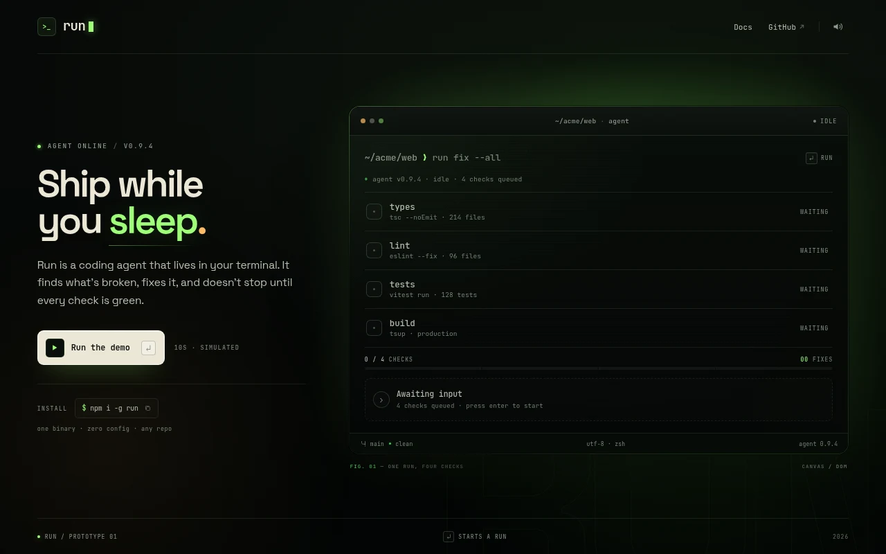
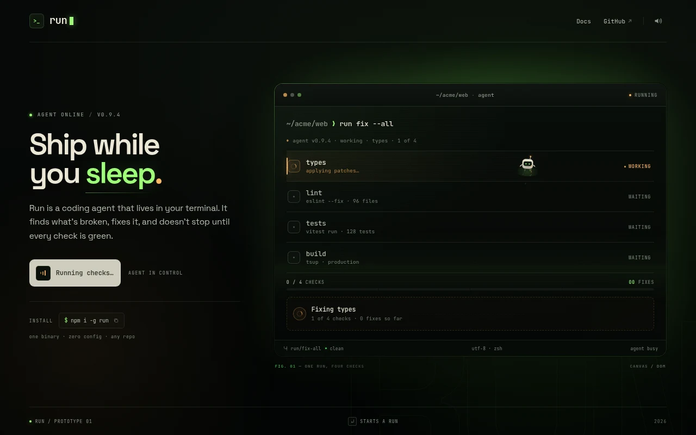
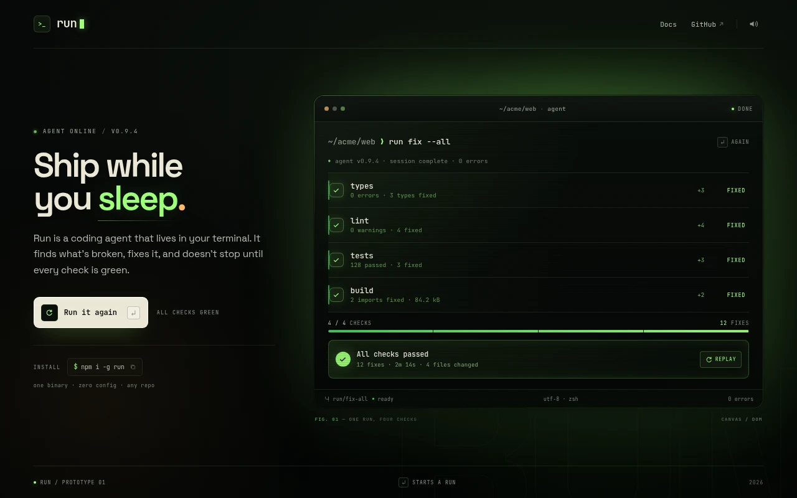
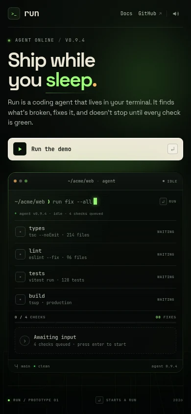

# Run — the living terminal (prototype)



Run is a one-screen landing page for a terminal-native coding agent. The product demo is the terminal itself: a command types itself, tiny robots drop out of the prompt, and four checks turn green one at a time.

Press `Enter` (or click **Run the demo**). That is the whole interaction.



## Run it

```bash
npm install
npm run dev
```

Open the URL Vite prints (defaults to `http://localhost:5173`). Build with `npm run build`.

## What is implemented

- A static-first landing page with a CRT-inspired identity: near-black, phosphor lime, amber, cream, JetBrains Mono, and a terminal with chrome, scanlines, and a vignette.
- A large terminal window with a real prompt (`~/acme/web ❯ run fix --all`), agent status line, four task rows, progress meter, and a result panel.
- A scripted run state machine: `idle → typing → running → complete`. The command types character by character; each task moves `waiting → working → fixed`; the meter and fix counter advance; the run ends with `All checks passed · 12 fixes · 2m 14s`.
- Canvas 2D robots: cream rounded-rect bodies, glowing eyes, antennae, hover jets, and wobble. They spawn from the command caret, fly a curved path to the active row, blink, emit sparks while working, pop a checkmark, and disappear.
- A damped canvas scene with ambient dust, trail particles, spark gravity, a work beam, and a completion ring.
- A tiny Web Audio synthesizer, started only from a user gesture: typing ticks, robot spawn blips, spark ticks, task pings, and a soft final chord. The header has a persistent mute toggle. No audio files.
- Reduced-motion support: the canvas is hidden, no robots or particles spawn, statuses still change, and the final summary still appears.
- Responsive layout at 1280×800 and 390×844, plus a stacked tablet layout.
- Keyboard support: `Enter` starts or replays, Run/Replay are real buttons with visible focus states, and the mute/install controls are reachable.
- The canvas and timeline pause when the tab is hidden or the terminal scrolls out of view.
- A copy-to-clipboard install command and a demo replay state with two ways back in.



<p align="center">
  
</p>

## How it works

```
index.html          the page shell and terminal structure
src/main.ts         task data, run state machine, DOM updates, frame loop
src/robots.ts       canvas scene, robot paths, particles, dust
src/audio.ts        Web Audio graph and synthesized sounds
src/style.css       layout, terminal styling, motion, responsive rules
```

`src/main.ts` drives the run with an abortable async sequence. Every wait goes through a small frame-clock queue that only advances while the page is visible and the terminal is intersecting the viewport. A single `requestAnimationFrame` loop advances both the timeline and the canvas, so a hidden tab pauses the whole demo instead of skipping to the end.

The robots live in a DPR-scaled Canvas 2D layer over the terminal content. A robot stores a cubic Bézier path from the caret to the active row; once it arrives it bobs, blinks on a staggered cycle, and emits sparks and low-volume ticks. Finishing a task triggers a hop, a checkmark particle, and an expanding ring while the DOM row flips to its fixed state.

The run is a simulation, not a real command runner. The terminal narrative says `2m 14s`; the choreography is compressed to roughly ten seconds.

## Prototype notes and rough edges

- The Docs and GitHub links are placeholders; the install button really copies its command.
- The task fixes are scripted. The underlying state machine is easy to point at a real runner later.
- Reduced motion keeps the same timing but removes the canvas and motion effects.
- Audio is intentionally quiet. The muted state is stored in `localStorage`.
- The browser's tab-throttling can make the sequence run slower in a background tab; the loop pauses rather than skipping ahead.

## Next steps

- Replace the scripted task data with a real runner feed (SSE or a WebSocket) and a sandboxed demo repo.
- Add task expansion for real log output, without giving up the single-screen composition.
- Build a capture/poster mode for docs and social images.
- Add a small `?test` or injected-state hook for deterministic screenshots at arbitrary points.
- Tune robot density and paths for narrow screens and ultrawide terminals.
- Add a keyboard-accessible focus shortcut for the terminal, plus an explicit reduced-motion override.
- Give the links real destinations and add a short manifesto or install section below the fold.

## Notes

This is an original prototype built around a few principles: static-first, one diegetic interaction, a physical metaphor, and sound that starts only when you do. No third-party assets, audio, or code are used.

The prototype lives in `run`. The other prototypes are `hush`, `morph`, `capture`, and `wave`.
